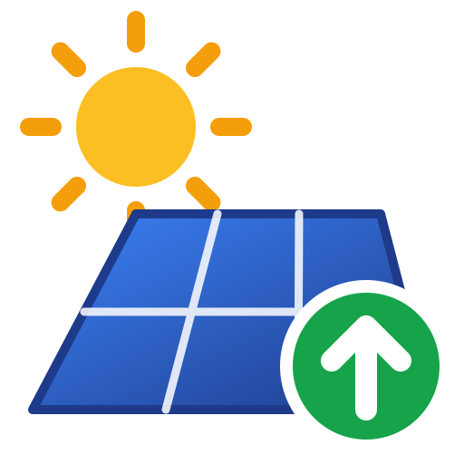
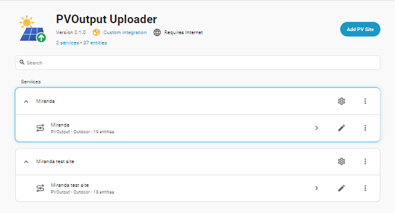
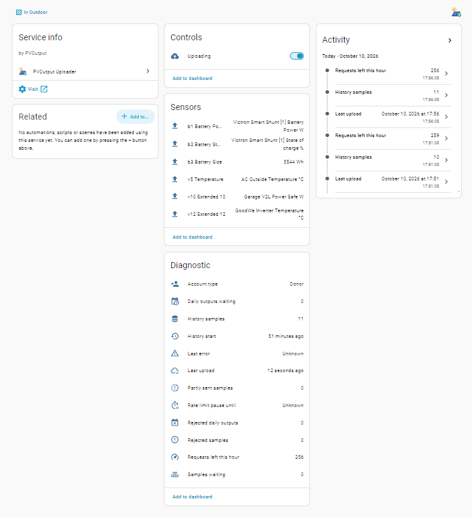
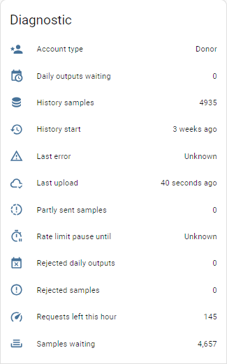

# PVOutput Uploader for Home Assistant

Send your Home Assistant solar, consumption, battery and other numeric sensor readings
to [PVOutput](https://pvoutput.org), with local recording and automatic upload recovery.
Fields can also be read back from PVOutput into sensors (download), per field.

## Quick start

1. Add this repository to HACS as a custom repository (type *Integration*), install
   **PVOutput Uploader** and restart Home Assistant.
2. **Settings → Devices & services → Add integration → PVOutput Uploader**, enter the API
   key and system ID from pvoutput.org (*Settings → API Settings*). The status interval
   and donor status are read from your account. Use **Add PV Site** to add another system.
3. Open **Configure → Add field** and add the sensors or fixed values to send.
   Available fields depend on donor status; see **How it works → Donor features** for details.
   For sensors without a unit, enter **Source / custom unit** when prompted.
4. Optional: **Configure → Import history from Home Assistant** to fill the log for the
   days before installing, and send them. Statuses go up to 100 per request (donor),
   battery fields included, so weeks of history take minutes.

If you already send to PVOutput with a `rest_command` automation, switch it off once the
fields are added, so statuses are not sent twice.

## Screenshots

**Your PV sites** — add another site with **Add PV Site**, or configure an existing one.



**Field mappings, upload controls and diagnostics**

Friendly source names and upload units are shown beside each field, including fixed
battery capacity in Wh. Diagnostics show stored history, waiting and rejected samples,
partly sent samples, and the remaining API allowance.



The integration keeps its **own history log**: every 5 minutes it stores the values of
every configured sensor, and it keeps them for **91 days** (configurable), however short
Home Assistant's recorder history is. Whatever stops the uploads (PVOutput down, the
internet out, the hourly limit, uploading switched off), the data waits in the log and is
sent automatically when uploading resumes, within PVOutput's history limits. Rejected
values may need correction and reupload. Like the PVOutput
service of the IoTaWatt firmware, any period in the log can also be sent again.

## Where your data lives

| | What it holds | How long | Used for |
|---|---|---|---|
| **History log** (`pvoutput_uploader_<system id>.db` in the configuration folder) | 5 minute values of every configured sensor, active and passive, temperatures included | **91 days** by default (*Settings → Keep history for*): the 90 days donors can send statuses for, plus today | Everything that is sent and reuploaded |
| Home Assistant **recorder** states | Every state change of the sensors | `purge_keep_days` of the recorder (10 days by default) | Feeding the log every minute, and catching up after the integration was not running |
| Home Assistant **long term statistics** | Hourly mean/min/max, or energy change, of sensors that have a `state_class` | Forever | Only **Import history**, for periods the log never recorded |

The log is part of Home Assistant backups, and it survives removing and re-adding the
integration (it is named after the PVOutput system ID).

So the recorder only has to cover the longest time the integration might not be running,
and long term statistics are only needed for time before the integration was installed.

### How long data is kept, and how to change it

**History log: 91 days by default.** That is the 90 days PVOutput accepts statuses from
donor accounts, plus today; standard accounts can send statuses for 14 days. Older rows
are deleted once a day. Change it under **Configure → Settings → Keep history for**
(30 to 3650 days). Keep it longer if you want to be able to resend older days as daily
totals. The log is small: about 105,000 rows a year (288 a day), a few MB.

**Home Assistant recorder: 10 days by default.** This is Home Assistant's
`purge_keep_days`, not a setting of this integration. It decides how long the integration
can be stopped (disabled, broken, being reinstalled) and still fill the log with full 5
minute detail when it runs again. To cover longer stops, raise it in `configuration.yaml`:

```yaml
recorder:
  purge_keep_days: 20
```

A longer recorder history makes Home Assistant's database bigger, for all entities, not
only these sensors.

**Long term statistics: kept forever**, but only for sensors with a `state_class` (most
energy and power sensors have one; some temperature sensors do not). They are used only by
**Import history**. To make sure a sensor gets them from now on, give it a state class:

```yaml
homeassistant:
  customize:
    sensor.outside_temperature:
      state_class: measurement
```

## What happens when uploads are disrupted

**You do nothing** when:

| Disruption | What happens |
|---|---|
| PVOutput down, network error, timeout | Recording continues. The backlog is sent oldest first once PVOutput answers again. |
| Hourly request limit reached | Uploading pauses until PVOutput's reset time, then continues where it stopped. The pause survives restarts. |
| **Uploading** switched off | Recording continues. The backlog is sent when it is switched back on. |
| PVOutput does not confirm a status (a batch answers `0`, or the status lacks v1-v4 because IoTaWatt has not created it yet) | Only statuses PVOutput confirms count as sent; the rest are retried for two hours. |
| PVOutput rejects one value of a status (power or energy too high, generation at night) | The status is sent once more without the value PVOutput named, so the other fields still arrive. It is counted as **Partly sent** and stays unsent for a reupload. Other rejections are not retried. |
| Integration disabled, reloaded or reinstalled while Home Assistant runs, for less time than the recorder keeps states | On start, the log is filled from the recorder for the whole missed period with full 5 minute detail (about 2 days of history per minute), and the backlog is sent. |
| Home Assistant itself off | No sensor states are recorded during the outage. If an energy counter continues counting and its readings span the gap, the builder can recover the accumulated energy when readings resume; it cannot reconstruct individual readings during the outage. |

**Daily totals are not sent routinely**: PVOutput works out each day's totals from the
statuses. They are sent only for days too old for statuses, on request or with the
fallback setting below.

**PVOutput's own limit:** it takes statuses only for the last **14 days** (**90** for
donors). A backlog older than that stays in the log; send it as daily totals with
**Reupload history**, or turn on the *daily output fallback* setting to do that
automatically.

**You use the Configure menu** only when:

| Situation | Action |
|---|---|
| PVOutput rejected a status, or part of it (shown in **Rejected samples** and **Partly sent samples**) | Fix the cause (e.g. the sensor), then **Reupload history → since the first unsent status** |
| PVOutput rejected a daily total (shown in **Rejected daily outputs**) | **Reupload history** for that day, sent as daily totals |
| You want a period sent again (e.g. a field was made active, or PVOutput data was edited) | **Reupload history → from a date and time** |
| The integration was not running for longer than the recorder keeps states | **Import history from Home Assistant** fills the rest from hourly statistics (sensors without a `state_class` have none) |
| You want PVOutput filled for the time before installing | **Import history from Home Assistant** with *Send to PVOutput* on |

The **Samples waiting**, **Rejected samples** and **Daily outputs waiting** sensors show
what is outstanding at any time.

## Configure menu

Everything is under **Settings → Devices & services → PVOutput Uploader → Configure**.
Each action saves as soon as it is submitted.

- **Add field**: first choose where the value comes from:
  - **A sensor**: pick the sensor and the PVOutput field it fills (only fields not used
    yet, and donor fields only for donor accounts). Then name it as in PVOutput, choose
    whether it is **active**, and, where a field allows it, how the 5 minute values of an
    interval are combined: average, last value, or energy since midnight.
  - **A fixed value**: the same number in every status, e.g. the battery size for `b3`
    (for `b6`, the battery state, you pick the state from a list). It is not logged and
    never sends a status on its own.
  - **From PVOutput**: the field is read from PVOutput into a sensor instead of sent
    (see **Field modes** and **Download** below). No Home Assistant source is needed.

  Each PVOutput field can be used once. The lists offer only fields still free, and the
  choice is checked again when you submit, against the configuration as saved at that
  moment, so a field added meanwhile in another Configure window is refused (and
  nothing that window saved is lost). When every field the account can send is
  configured, **Add field** is not shown and the menu says why: on a standard account
  that is v1-v6, as extended and battery fields need a donor account.
- **Edit field** / **Remove fields**. A field added from PVOutput can be given a sensor
  or fixed value here, ready for switching it to upload.
- **Fields**: one page with every configured field, each set to **Send** (active),
  **Record only** (passive) or **Download**; see **Field modes** below. Setting a field
  that has no Home Assistant source (added from PVOutput) to Send or Record only asks
  for a sensor or fixed value on the next screen.
- **Reupload history**: send the log again, since the first unsent status or from a
  date and time.
- **Import history from Home Assistant**: fill the log from the recorder for a past
  period.
- **Settings**: account type, upload interval, history retention, daily output fallback.

### Fields

| Field | Meaning | Sent as |
|---|---|---|
| v1 / v3 | Energy generation / consumption | Wh since local midnight, from an energy sensor (lifetime or daily counters both work) |
| v2 / v4 | Power generation / consumption | W, average or last value |
| v5 | Temperature | °C |
| v6 | Voltage | V |
| v7-v12 | Extended (donor) | average, last value, or energy since midnight |
| b1 | Battery power (donor), **mandatory for battery data** | W (+ charging, − discharging) |
| b2 | Battery state of charge (donor) | % |
| b3 | Battery size (donor) | Wh |
| b4 / b5 | Battery lifetime charge / discharge (donor) | Wh |
| b6 | Battery state (donor) | State code: 0 Invalid, 1 Standby, 2 Thermal management, 3 Enabled, 4 Fault, 5-9 user defined. As a fixed value it is picked from this list. |

**b1 is mandatory for battery data.** PVOutput ignores b2-b6 in a status without b1, so
**Add field** offers b2-b6 only once b1 is configured, b1 cannot be removed while other
battery fields remain, and without an active b1 the other battery fields are not sent
(their field sensors say why).

**A b6 state when the battery does not report one.** Battery monitors such as a Victron
SmartShunt have no device state, but b6 can be worked out from what they do report:
battery power, an alarm flag and the alarm reason. A template sensor, mapped to b6 with
*Last value*:

```yaml
template:
  - sensor:
      - name: "Battery State"
        unique_id: battery_state_pvoutput
        state: >
          
          
          
           0
           2
           4
           3
           1
          
```

That is 0 Invalid when there is no data, 2 Thermal management on a temperature alarm, 4
Fault on any other alarm, 3 Enabled while charging or discharging (20 W or more, so noise
does not flip it), and 1 Standby otherwise. Replace the entity IDs with your battery's.
With ESPHome the same logic can run on the device as a `template` sensor.

Sensor units are converted (kWh to Wh, kW to W, °F to °C, ...). Sensors must be
recorded by the Home Assistant recorder (they are unless you excluded them).

### Field units

Field rows show the source friendly name and the unit sent to PVOutput, e.g. `Outside °C`. Fixed values show their unit, e.g. `5544 Wh` for battery size. Power uses W, energy Wh, voltage V and battery state of charge %; extended fields use your chosen unit.

Sensors with a unit are converted automatically. For a sensor without one, enter its actual **Source / custom unit** when adding or editing the field (e.g. kW or °F); this is used for conversion, not just a label. Leave it empty when the source reports its unit. Fixed values are entered in PVOutput units; a custom unit applies only to extended fields. Changing a unit affects newly recorded or explicitly rebuilt history; existing samples keep their recorded values.

### Field modes: Send, Record only, Download

Every configured field is in one of three modes. The mode decides what happens to the
field; its configuration (sensor or fixed value, name, unit, how values are combined)
is kept whatever the mode, so changing the mode never loses a setting.

| Mode | Its Home Assistant sensor is recorded in the log | Sent to PVOutput | Read from PVOutput |
|---|---|---|---|
| **Send** (active) | yes | yes | no |
| **Record only** (passive) | yes | no, unless chosen for a reupload or import | no |
| **Download** | yes, if it has a sensor (see below) | no | yes, into *<field> <label> from PVOutput* |

Two things belong to a field and are independent of each other:

- **Its source**: a Home Assistant sensor, a fixed value, or nothing (a field added
  with **Add field → From PVOutput**). Send and Record only need a source; Download
  does not.
- **Its mode**: what is done with it now.

**Where to change the mode.** Three places, all saving the same setting:

1. The field's **select** on the device page (under Configuration), e.g. *v5 Ambient*.
   Handy for dashboards and automations (`select.select_option`).
2. **Configure → Fields**: all fields on one page.
3. **Add field**: *A sensor* or *A fixed value* starts in Send (or Record only, if
   **Active** is off); *From PVOutput* starts in Download.

Saving reloads the site, which takes a few seconds.

**Which modes a field offers, and why.** Options are only offered where they can work:

| Field | Select on the device page | Configure → Fields |
|---|---|---|
| Has a sensor or fixed value, v1-v6 | Send, Record only, Download | Send, Record only, Download |
| Has a sensor or fixed value, v7-v12 | Send, Record only, + Download on a donor account | the same |
| Battery field b1-b6 | Send, Record only (PVOutput does not return battery values) | the same |
| No source (added from PVOutput) | **Download only** | Send, Record only, Download: choosing Send or Record only asks for a sensor or fixed value next |

The select cannot ask questions, which is why a field without a source offers only
Download there: give it a source under **Configure → Fields** (or **Edit field**) first,
and from then on its select offers all three. Both places check the choice again when
saving, against the field and account as saved at that moment, so a page left open
while something changed (e.g. the account stopped being a donor) cannot set what is no
longer possible; it shows an error and the options that apply now.

**Switching between upload and download.**

- *Send → Download*: sending stops, the download sensor appears. The field's sensor
  **keeps being recorded** in the log (never sent), so if you switch back later, the
  history has no gap and **Reupload history** can send it. What is downloaded is not
  written to the log: PVOutput holds that history, and the download sensor's own
  history is kept by Home Assistant's recorder.
- *Download → Send / Record only*: the download sensor goes away and the field's kept
  source is used again, with its full history in the log.
- *From PVOutput (no source) → Send*: you are asked for a sensor or fixed value; from
  then on it behaves like any other field. Its log starts at that moment, so import
  earlier history with **Import history from Home Assistant** if you need it.
- To stop recording a downloaded field's sensor, remove the field and add it again
  with **From PVOutput**.

**Passive (Record only) fields and history.** A passive field builds up history in the
log. To send that history, either make the field active (Send) and reupload, or keep it
passive and tick it under **Also send passive fields** when you reupload: it is then
sent for that period only, while live statuses keep it off.

**Working next to another uploader.** Fields that are not sent (Record only, Download)
or not configured are left empty, so PVOutput keeps what another uploader such as
IoTaWatt sent for the same time. PVOutput needs one of v1-v4 in a status; a status
holding only extra fields is retried for up to two hours, waiting for the other
uploader to create it. Download fits here too: let IoTaWatt send v1/v2 and download
them into Home Assistant, while this integration sends temperature and battery.

### Download

A field in **Download** mode is read from PVOutput instead of sent: its latest value
(`getstatus.jsp`) lands in a sensor named *<field> <label> from PVOutput*, e.g.
*v2 Power from PVOutput*, next to a **Normalised output from PVOutput** sensor (kWh/kW)
present while any field downloads.

- **When:** once per upload interval, whether or not **Uploading** is on. Each read is
  one request from the hourly limit, keeping the same reserve as uploads.
- **Values:** energy fields (v1, v3) count Wh since local midnight, so they work in the
  Energy dashboard. A value PVOutput does not have shows as unknown, not 0.
- **Freshness:** if reads keep failing (PVOutput or the network down, rate limit), the
  download sensors turn **unavailable** after three upload intervals rather than
  showing an old value as current. The `downloaded_at` attribute tells when the value
  was read, `pvoutput_status` which PVOutput status it is.
- **No status yet** (e.g. just after midnight): unknown. Any other rejection by
  PVOutput shows in **Last error** and is retried the next interval.
- **Battery fields (b1-b6) cannot be downloaded**: PVOutput does not return them.
  **Extended fields (v7-v12)** are returned to donors only. If the account stops being a
  donor, a v7-v12 download field stays configured but shows unknown, with the attribute
  `not_downloaded_because: needs a PVOutput donor account`.
- Download is the live value only; reading PVOutput history into statistics may come
  later.

## Reupload history

**Configure → Reupload history**, or the `pvoutput_uploader.reupload` action in scripts
and automations. The form shows how many samples are waiting, rejected or too old for
statuses, and when the first unsent one is. Start:

- **Since the first unsent status**: from the oldest status that is waiting, was rejected
  or became too old (`since_failure: true` in the action).
- **From a date and time** you choose (`start:` a date or a date and time).

…up to an end date and time (default now; the action also takes a day, meaning up to
its end), sent as:

- *Statuses where allowed, daily totals for older days* (default): days inside PVOutput's
  status window (14 days, 90 for donors) as statuses, older days as daily outputs
- *Statuses only*: only the days still inside the status window
- *Daily totals only*: daily outputs (generation, consumption, peak power, min/max
  temperature); these replace the day's totals in PVOutput

**Also send passive fields** (shown when the site has passive fields, all ticked by
default): the ticked passive fields are sent too, for the statuses of the chosen period
only. Live statuses and other periods keep them off. Each reupload or import keeps its
own choice for its own period, also while an earlier one is still sending; where periods
overlap, the newest choice wins. A status longer than 5 minutes that holds rows of two
choices sends the passive fields of both. A site whose fields are all passive still
sends what a reupload or import chose. Donor-only fields still need a donor account,
and battery fields need b1 (active or ticked too). In the action: `passive_fields: [v7, b2]`.

Battery fields (`b1`–`b6`) go in the same batches as the other fields, up to 100
statuses per request for donors, so three weeks of 5 minute statuses (6,048) take about
61 requests, and a few days of history go out in a moment. PVOutput's documentation
lists battery fields only for single statuses, but its batch service takes them as six
more columns after `v12` and stores them (tested: the battery values appear in
PVOutput).

For scripts and automations, `without_battery: true` on the `pvoutput_uploader.reupload`
action sends everything waiting up to that moment without battery values. It is no
longer needed for speed and is kept for compatibility.

Sending runs in the background at the pace the hourly request limit allows (60 requests
an hour, 300 for donors). The **Samples waiting** and **Daily outputs waiting** sensors
show the progress.

## Import history from Home Assistant

**Configure → Import history from Home Assistant**, or the
`pvoutput_uploader.import_from_recorder` action. Fills the log for a past period from the
recorder: 5 minute detail where recorded states still exist (10 days by default), hourly
long term statistics for whatever is still missing. Values already in the log are kept
(unless *Replace recorded values* is on); missing 5 minute rows and missing fields of
existing rows are filled. Within an hour, the energy from statistics is the hour's total
minus what recorded rows already hold, shared by the missing slots, so the hour still
adds up to the statistics; other values take the hour's value. If the recorded rows
already hold more energy than the statistics, they are kept as they are (real readings
win), the missing slots get 0, and a warning in the log names the hour.

With *Send to PVOutput* on, the imported period is sent like any backlog; with it off it
is only stored, ready for a later reupload.
**Also send passive fields** (shown when the site has passive fields, all ticked by
default): with *Send to PVOutput* on, the ticked passive fields are sent too, for the
imported period only, like on **Reupload history**. Statuses PVOutput already has for
that period are sent again to add them. In the action: `passive_fields: [v5]`.

**Historical uploads in progress.** This example shows 4,935 stored history samples,
with 4,657 still waiting to upload. The diagnostics show progress as the backlog is sent.



## How it works

- **History log.** Every minute the integration reads the closed 5 minute slots of all
  configured sensors from the recorder and stores them in
  `pvoutput_uploader_<system id>.db` in the configuration folder (included in Home
  Assistant backups). The log is always 5 minute resolution, whatever the upload
  interval, and is kept for 91 days by default.
- **Uploads.** Statuses are built from the log at the upload interval (the system's
  status interval in PVOutput, or set by hand) and sent oldest first, up to 30 per
  request (100 for donors). Only statuses PVOutput confirms in its answer count as sent.
  A rejected batch is split until the status PVOutput objects to is found, so one bad
  value does not hold up the rest.
- **Unavailable sensors** leave a gap in the log rather than a value: no average, no
  last value, and no energy for a slot with no counter reading. Energy is counted when
  the counter reports again.
- **Rate limit.** The `X-Rate-Limit-*` headers of every answer are tracked, and the last
  5 requests of each hour are kept in hand: the limit belongs to the API key, so other
  uploaders using the same key (e.g. IoTaWatt) still have room. Current statuses (the last
  two upload intervals) are sent first, before any history. History (backlog, reuploads,
  daily totals) leaves just enough requests for every current status due before the
  hour resets, plus one: on a 5 minute site with 40 minutes to go it stops at 5 + 8 + 1
  = 14 requests left, near the end of the hour at 7. So a long backlog uses almost the
  whole hour and still never holds up live data. Requests are sent at least 0.3 seconds apart, so a backlog goes out
  at a steady pace rather than in a burst.
- **Donor features** are detected from the account (or set by hand): extended fields
  v7-v12, battery fields b1-b6, statuses 90 days back and 100 per request.
  Donor status is detected when the integration is first added and whenever it reloads.
  If you become a PVOutput donor later, reload the integration to make extended
  parameters (`v7`–`v12`) and battery fields (`b1`–`b6`) available, or select
  **Donor** manually under Account type.
- **Battery fields** go in the same batches as the other fields, as six columns after
  `v12` (b1-b6). PVOutput documents them only for single statuses; its batch service
  takes and stores them all the same (tested).

## Entities

The PVOutput system's device page shows what is uploaded and as what:

- **One sensor per configured field**, named after the PVOutput field and your label (e.g.
  *v5 Ambient*). Its state is the source sensor's friendly name or fixed
  value, followed by the upload unit (e.g. *Outside °C* or *5544 Wh*). The source entity ID is available in the `source_entity` attribute;
  `source_unit` and `pvoutput_unit` show the source and upload units. Attributes: the PVOutput field and its standard name, active or passive,
  `configured_to_send` (active and allowed by the account type; donor-only fields on a
  standard account are not), how the 5 minute values are combined, and the last recorded
  value with its time. The icon follows `configured_to_send`. It does not show whether
  uploading is switched on or what PVOutput accepted: see the **Uploading** switch and the
  diagnostic sensors for that.
- **Uploading** switch: stops sending while recording carries on.
- **One select per field** (e.g. *v5 Ambient*), under Configuration: **Send**,
  **Record only** or **Download**, offering only what the field can do (see **Field
  modes** for which options appear and why). Changing it saves the configuration and
  the site reloads to apply it, which takes a few seconds. (Before 0.1.7 these were
  *Send <field>* switches; they are removed on update, so automations using them need
  `select.select_option` instead.)
- **Download sensors**, one per downloaded field (*v2 Power from PVOutput*), plus
  **Normalised output from PVOutput**.
- **Clear queued history** button (under Controls, next to Uploading): takes the waiting history off the queue (statuses
  older than the last two upload intervals, and queued daily totals) and ends a "leave
  out battery fields" run. Current statuses keep going. Nothing is deleted: cleared
  statuses stay in the log as unsent (**Cleared samples**), and **Reupload history**,
  also *since the first unsent status*, sends them again.
- Diagnostic sensors: last upload (and last download while a field downloads; both kept across restarts and reloads), samples waiting, daily outputs waiting, rejected
  samples, partly sent samples, cleared samples, sent without battery, rejected daily
  outputs, history size and start, requests left this hour, rate limit pause, account
  type, last error.

## Settings

- **Account type**: detect from PVOutput, donor or standard.
- **Upload interval**: from PVOutput, 5, 10 or 15 minutes.
- **Keep history for**: days the log is kept (default 91: the 90 days donors can send statuses for, plus today).
- **Daily output fallback**: when statuses become too old to send, send that day's
  totals as a daily output instead. Off by default, because it replaces the day's totals
  in PVOutput.

Debug logging shows every PVOutput request and answer:

```yaml
logger:
  logs:
    custom_components.pvoutput_uploader: debug
```

## Development

Tests run in a test Home Assistant:

```bash
pip install pytest-homeassistant-custom-component
python -m pytest tests
```

The recorder's libraries (SQLAlchemy and others, listed in Home Assistant's
`components/recorder/manifest.json`) must be installed too; CI does this.

Releasing: bump `version` in `manifest.json`, add a `## <version>` section to
`CHANGELOG.md` and push to `main`. When the tests, hassfest and the HACS checks pass,
the release workflow tags `v<version>` and publishes a GitHub release (a pre-release
for versions such as `0.0.1b2`).

The icon's source is [`docs/images/icon.svg`](docs/images/icon.svg); the PNGs in
`custom_components/pvoutput_uploader/brand/` (256 and 512 px) are rendered from it.
Home Assistant 2026.3+ shows them in place of the brands repository.

## License

[GNU General Public License v3.0](LICENSE).
